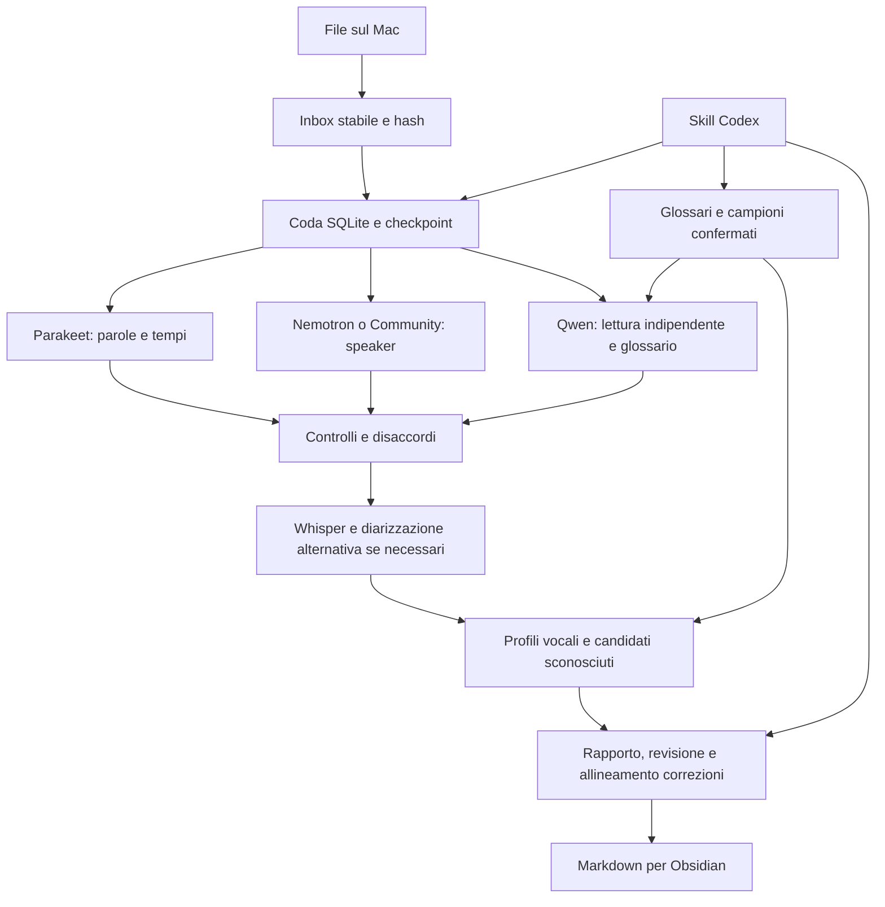

# Architettura e contratti

Un repository, un package Python, tre skill. Il motore deterministico gestisce stato, file e modello selezionato; Codex aiuta ad avviare, rivedere e insegnare il lessico. Non è necessario mantenere una chat aperta per elaborare una registrazione.

## Estensione

- **ASR**: adattatore che restituisce `text`, `words` con `start/end/text/confidence` e/o `segments`, nome motore e percorso dell'output grezzo. Un timestamp di chunk non viene trattato come timestamp di parola.
- **Diarizzazione**: `segments` con `speaker/start/end`, conteggio e numero eventualmente imposto. ID di riunioni/modelli diversi non sono identità confrontabili direttamente.
- **Embedding**: vettore normalizzato e `model_id` derivato dai file del modello; confronto solo fra rappresentazioni compatibili. I campioni di query sono estratti da intervalli privi di sovrapposizione secondo la diarizzazione corrente.
- **Sorgente**: scrive il file finito e, facoltativamente, metadati JSON nell'inbox. API/webhook di un registratore, iCloud o esportazione manuale possono usare lo stesso ingresso senza cambiare il motore.
- **Destinazione**: il primo adattatore esporta Markdown senza sovrascrivere note differenti. Un futuro writer Obsidian può aggiungere collegamenti, cartelle e riepiloghi mantenendo la provenienza.
- **Ricetta**: file JSON con motori, ambito della seconda lettura, budget dei tentativi e soglie. L'implementazione valida le combinazioni supportate: non basta inserire un nome di modello inesistente.

## Stato e riproducibilità

L'identità di un job comprende hash del contenuto, parametri, ricetta, snapshot della conoscenza, runtime e versione del motore. Gli step registrano running/complete e scrivono JSON atomicamente. Gli input originali sono copiati e verificati; gli output derivati sono locali. Aggiornare il codice richiede aggiornare la versione quando cambia il comportamento dei risultati.

Gli stati principali sono queued → running → needs_review / ready, oppure failed. La conferma di tutti gli elementi porta a reviewed. Una ripartenza esegue gli step mancanti; il worker è seriale per evitare competizione tra modelli sulla memoria del Mac.

## Qualità e limiti espliciti

La prima versione seleziona Parakeet come testo di base e conserva Qwen/Whisper come evidenza alternativa. Non è ancora attivo un arbitro che sostituisce automaticamente le frasi discordanti. Il costo evitato è una correzione automatica apparentemente fluida che peggiora l'audio originale.

Le segnalazioni includono punteggi bassi, ripetizioni, intervalli con parlato ma senza testo, timestamp anomali, alias del glossario, speaker brevi e disaccordi fra testi. Il parlato è attualmente stimato dal diarizzatore: un VAD indipendente è un'estensione prevista. Uguaglianza del conteggio speaker non elimina una segnalazione sulle attribuzioni.

La diarizzazione alternativa è globale, non una sostituzione cieca di microsegmenti. I candidati sono conservati ma la scelta/riconciliazione automatica dei cluster è ancora da sviluppare. La revisione attuale permette nomi per cluster, non l'editing grafico delle frontiere speaker.

La seconda lettura può concordare su un errore e la confidenza può essere elevata su una parola sbagliata. Il disaccordo non è WER. L'allineamento del testo non ne certifica la correttezza. L'accettazione automatica delle identità richiede una politica valutata: la presenza di un file di evidenza è tracciabilità, non una certificazione eseguita dal software.

## Confine GitHub / dati locali

Versionare codice, skill, ricette generiche, documentazione e test senza contenuti reali. Audio, trascrizioni, nomi, embedding, glossari personali, SQLite, token e percorsi personali restano nella home dati esterna. I job possono contenere uno snapshot completo della conoscenza: devono restare locali anche quando il repository è privato.

Fonti dei runtime: [FluidAudio](https://github.com/FluidInference/FluidAudio), [Nemotron-3](https://huggingface.co/nvidia/Nemotron-3-Diarization), [Qwen3-ASR](https://huggingface.co/Qwen/Qwen3-ASR-1.7B), [Community-1](https://huggingface.co/pyannote/speaker-diarization-community-1). Le licenze dei singoli modelli restano quelle dei rispettivi fornitori.
