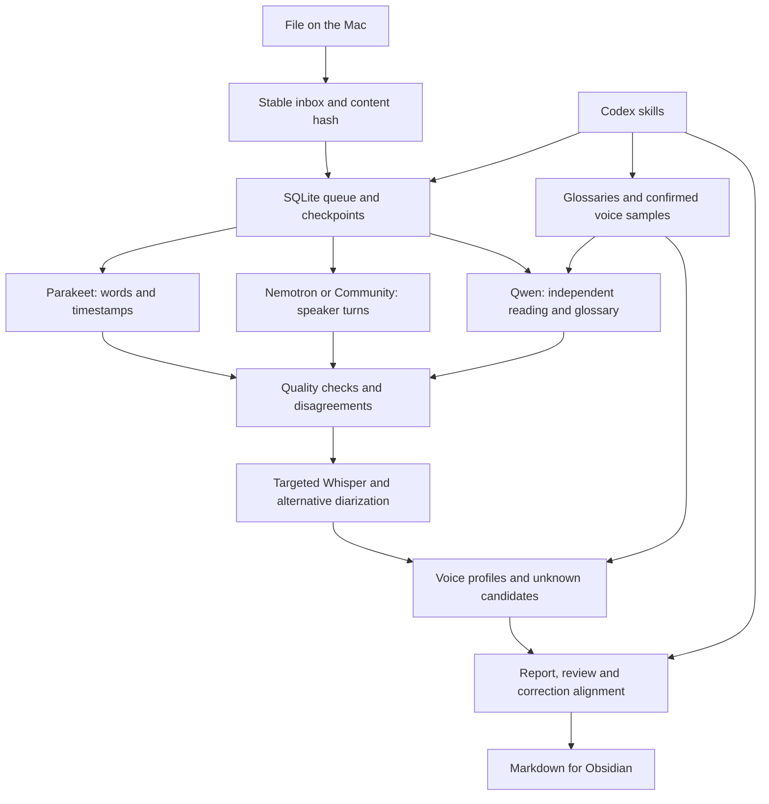

# Architecture and contracts

One repository, one Python package, three skills. The engine manages state, files and model selection; Codex helps start jobs, review issues and maintain terminology. Processing does not require an open chat.

## Extension points

- **ASR:** returns `text`, `words` with `start/end/text/confidence` and/or `segments`, engine name and raw output path. Chunk timestamps are not word timestamps.
- **Diarization:** returns `segments` with `speaker/start/end`, speaker count and any count constraint. IDs from different meetings or models are not directly comparable identities.
- **Embedding:** returns a normalized vector and a `model_id` derived from model files. Compare only compatible representations. Query clips exclude overlaps according to the current diarization.
- **Source:** writes a completed audio file and optional JSON metadata to the inbox. Recorder APIs/webhooks, iCloud or manual export can share this input contract.
- **Destination:** the initial adapter exports Markdown without overwriting different notes. A future Obsidian writer can add folders, links and summaries while preserving provenance.
- **Recipe:** JSON defines engines, second-pass scope, attempt budget and thresholds. The implementation validates supported combinations; an arbitrary model name is not enough to add a backend.
- **Evaluation:** reference-based metrics are separate from processing heuristics. A public-corpus runner uses the same ASR adapters, keeps raw outputs and scores identical audio/reference pairs. It does not enable automatic text replacement.

## State and reproducibility

Job identity includes the audio content hash, parameters, recipe, knowledge snapshot, runtime and engine version. Steps record running/complete state and write JSON atomically. Original inputs are copied and verified; derived outputs remain local. Bump the engine version when code changes affect generated results.

Main states are queued → running → needs_review / ready, or failed. Resolving all issues leads to reviewed. Restarting executes missing steps. The worker is serial to avoid model contention for Mac memory.

The evaluation runner acquires the same worker lock, fingerprints model files and inference code, and caches candidates by audio, runtime, language and engine. Scoring can be repeated against saved candidates. Evaluation data and reference text stay outside the repository.

## Quality and current limits

The current recipe selects Parakeet as its base text and retains Qwen/Whisper as alternative evidence. It does not automatically replace disputed sentences.

Checks cover low scores, repetition, speech intervals without text, abnormal timestamps, glossary aliases, short speaker clusters and disagreements. Speech activity is currently estimated by the diarizer; an independent VAD is planned. Agreement on speaker count does not resolve assignment concerns.

Alternative diarization runs globally. Candidates are preserved, but automatic cluster selection/reconciliation is not implemented. Review supports cluster names, not graphical editing of speaker boundaries.

Two models can agree on an error, and an incorrect word can receive high confidence. Disagreement is not WER. Forced alignment does not certify text. Automatic identity acceptance requires an evaluated policy: recording an evidence file provides traceability, not software certification of that evidence.

## Public code and local data

Version code, skills, generic recipes, documentation and tests without private content. Recordings, transcripts, names, embeddings, personal glossaries, SQLite, tokens and personal paths stay in the external data home. Jobs can include a complete knowledge snapshot and must remain local even if a checkout is private.

Runtime sources: [FluidAudio](https://github.com/FluidInference/FluidAudio), [Nemotron-3](https://huggingface.co/nvidia/Nemotron-3-Diarization), [Qwen3-ASR](https://huggingface.co/Qwen/Qwen3-ASR-1.7B), [Community-1](https://huggingface.co/pyannote/speaker-diarization-community-1). Each model retains its provider's license.
